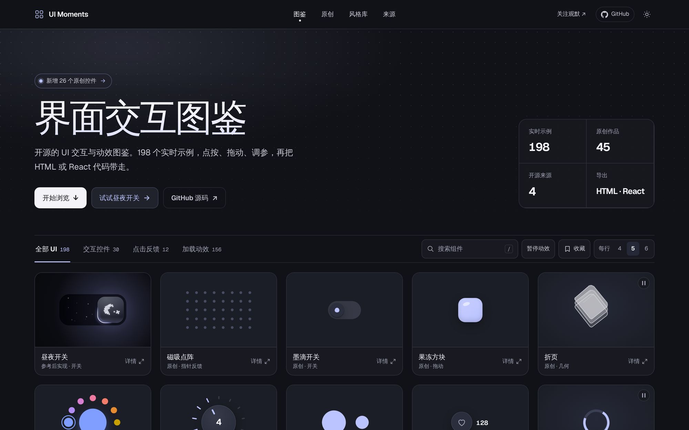

<div align="center">

<a href="https://guanmo-ai.github.io/ui-moments/"></a>

# UI Moments

**An open-source gallery of UI interactions and motion.** 198 live examples you can poke, drag and tune — then take the HTML or React code with you.

[](https://github.com/guanmo-ai/ui-moments/actions/workflows/pages.yml)
[](LICENSE)
[](package.json)

[**Open the gallery ↗**](https://guanmo-ai.github.io/ui-moments/) · [Originals](https://guanmo-ai.github.io/ui-moments/gallery/originals/) · [Style library](https://guanmo-ai.github.io/ui-moments/styles.html) · [Credits](CREDITS.md) · [中文](README.md)

<a href="https://guanmo-ai.github.io/ui-moments/">
  <picture>
    <source media="(prefers-color-scheme: light)" srcset="docs/assets/preview-light.jpg">
    
  </picture>
</a>

</div>

> The site UI is in Simplified Chinese. Component names, code exports and this README are readable without it.

## Highlights

- **Try first, read later.** The top half of every card *is* the component. The bottom half opens details, parameters and code.
- **Exports that just work.** Tune size, color and tempo of any loader, then copy a self-contained HTML page or a React example. The license travels with the code.
- **Recreation prompts.** Copy a prompt that carries the current parameters, source links and license terms for your AI coding assistant.
- **Honest provenance.** Every card is labeled *Original*, *Open-source integration* or *Inspired re-implementation*. Upstream code is vendored byte-for-byte at a pinned version. See [CREDITS.md](CREDITS.md).
- **Accessible by default.** Keyboard support, light/dark themes, `prefers-reduced-motion`, and off-screen animations pause automatically.

## What's inside

| Category | Count | Includes |
| --- | ---: | --- |
| Controls | 30 | 26 **original controls**, Day/Night Toggle, Elastic Slider, Alignment Switch, Bookmark Button |
| Tap feedback | 12 | Micron.js bounce, wobble and blink effects |
| Loaders | 156 | 19 originals, 44 LDRS, 47 Loading UI, 46 SVG Spinners |

### Original controls

26 controls designed from scratch, grouped into four single-file pages with no dependencies. All support keyboard and reduced motion.

| Page | Controls |
| --- | --- |
| [Visual](https://guanmo-ai.github.io/ui-moments/gallery/originals/visual.html) (no text) | Magnet Grid · Jelly Cube · Hue Orbit · Merge Drops · Pull Cord Lamp · Flip Coin · Ripple Pad · Bloom Toggle |
| [Core](https://guanmo-ai.github.io/ui-moments/gallery/originals/) | Ink Switch · Detent Dial · Hold to Confirm · Odometer Stepper · Leaf Tabs · Tide Progress |
| [Actions](https://guanmo-ai.github.io/ui-moments/gallery/originals/actions.html) | Copy Button · Like Burst · Paper Plane Send · Download Ring · Code Shake · Bell Toggle |
| [Forms](https://guanmo-ai.github.io/ui-moments/gallery/originals/inputs.html) | Stroke Checklist · Pebble Rating · Notch Slider · Strength Meter · Chip Input · Plan Picker |

Plus 10 original loaders.

## Quick start

Requires Node.js 22.12+ (22 LTS or 24+), npm and Python 3.

```bash
git clone https://github.com/guanmo-ai/ui-moments.git
```

```bash
cd ui-moments && npm run setup
```

```bash
npm run dev
```

Open <http://127.0.0.1:5173>. The site itself is framework-free static HTML; edit and refresh.

## Checks

```bash
npm run build && npm run lint && npm test
```

```bash
npm run package:site && npx playwright install --only-shell chromium && npm run test:browser
```

## Contributing

New components, fixes and polish are welcome. Please read [CONTRIBUTING.md](CONTRIBUTING.md) first — it explains how to add a work, how to document its origin, and what can never be committed. By participating you agree to the [Code of Conduct](CODE_OF_CONDUCT.md). Report security issues privately as described in [SECURITY.md](SECURITY.md).

## License & credits

Created and maintained by Guanmo ([@guanmo_ai](https://x.com/guanmo_ai)). UI Moments' own code is released under the [MIT License](LICENSE).

LDRS (Griffin Johnston / UI Ball), Loading UI (Bartosz Zagrodzki), SVG Spinners (Utkarsh Verma), Micron.js (Webkul) and the Geist typeface (Vercel) remain under their authors' copyrights and licenses. The complete list is in [CREDITS.md](CREDITS.md); full license texts are in [THIRD_PARTY_NOTICES.md](THIRD_PARTY_NOTICES.md).
