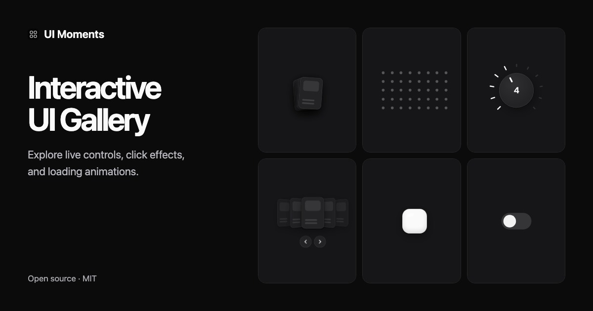

# UI Moments · 界面图鉴

UI Moments 收录可直接操作的界面组件和动效。每个组件在主画廊逐个运行，按用途分类。点击名称旁的放大按钮可打开详情，加载动效还提供参数调整、代码下载和提示词复制。

[在线画廊](https://guanmo-ai.github.io/ui-moments/) · [风格库](https://guanmo-ai.github.io/ui-moments/styles.html)

[](https://guanmo-ai.github.io/ui-moments/)

## 收录内容

| 作品 | 实现与来源 |
| --- | --- |
| [9 款加载微动效](index.html?q=加载微动效) | UI Moments 原创动效。并列展示形式参考 [Ramin Nasibov](https://x.com/RaminNasibov/status/2122045748623609935) |
| [折页](index.html#paper-fold) · [回信](index.html#signal-return) | UI Moments 构思、AI 辅助实现的动效实验 |
| [44 款 LDRS](index.html#ring) | 集成 Griffin Johnston / UI Ball 的 [LDRS 1.1.9](https://github.com/GriffinJohnston/ldrs)，保留原始动效、MIT 许可及[独立调整页](gallery/loaders/README.md) |
| [47 款 Loading UI](index.html#loading-ui-ring) | 集成 Bartosz Zagrodzki 的 [Loading UI](https://github.com/turbostarter/loading-ui)，保留 React、CSS、SVG、Motion 实现及 [MIT 许可](gallery/loading-ui/README.md) |
| [46 款 SVG Spinners](index.html#svg-spinner-gooey-balls-1) | 集成 Utkarsh Verma 的 [SVG Spinners](https://github.com/n3r4zzurr0/svg-spinners)，保留 CSS 和 SMIL 源码，以 CSS 版展示，采用 [MIT 许可](gallery/svg-spinners/README.md) |
| [12 种 Micron 点击反馈](index.html#micron-jelly) | 复用 [Webkul / Micron.js](https://github.com/webkul/micron) 的 CSS 动效并单独设计操作按钮，采用 [MIT 许可](gallery/micron/README.md) |
| [弹性控件](gallery/elastic-controls/) | 弹性滑尺、对齐拨片和夹页键。参考 [@yui540](https://x.com/yui540/status/2120825584947487170) 的回弹节奏，独立设计与实现 |
| [日期选择器](index.html#date-picker) | UI Moments 编写的[基础日期组件](gallery/date-picker/README.md)，支持周视图、月视图和键盘操作 |
| [昼夜开关](gallery/day-night-toggle/) | 参考 [@kaolti](https://x.com/kaolti/status/2119151022014894260) 的交互，独立实现像素重组、拖动停留和轮廓光 |

[风格库](styles.html)可操作弹性滑尺、对齐拨片、夹页键、日期选择器和折页动效，并在原版、孟菲斯、包豪斯和像素风之间切换。

## 本地运行

需要 Node.js 22.12+（22 LTS 或 24+）、npm 和 Python 3。在仓库根目录运行：

```bash
npm run setup
npm run dev
```

打开 [http://127.0.0.1:5173](http://127.0.0.1:5173)。`setup` 根据锁文件安装依赖，`dev` 先构建所需资源，再启动本地服务。`npm run dev:date` 可单独调试日期选择器。

## 检查与发布

```bash
npm run build
npm run lint
npm test
npm run package:site
npx playwright install --only-shell chromium
npm run test:browser
```

`npm test` 检查分类、日期边界、导出和随附许可。浏览器测试把 `_site/` 作为站点子路径启动，验证画廊、风格库、日期、下载和复制。`npm run package:site` 使用 Git 已跟踪的站点文件和构建产物，新增站点文件需先加入 Git。GitHub Actions 对主分支的变更和 PR 执行检查，主分支通过后发布到 GitHub Pages。

## 录制视频

昼夜开关和光照场景由虚拟时钟逐帧推进。完成 `npm run setup` 后安装 Chromium 与 ffmpeg，再运行：

```bash
npx playwright install --only-shell chromium
npm run record:toggle          # out/day-night-toggle.mp4，2880×2160，60fps
npm run record:light-scenes    # out/light-scenes.mp4，2880×1800，60fps
```

录制器参数见 [tools/record.js](tools/record.js)。

## 新增作品

1. 在 `gallery/<作品名>/` 添加可操作的页面和 README，记录来源、采用的实现与本站改动。
2. 在 [gallery/works.js](gallery/works.js) 注册组件，并在 [assets/catalog.mjs](assets/catalog.mjs) 确认用途分类。
3. 用画廊卡片、放大详情和独立入口验证组件。来源说明见[参考与署名](docs/attribution.md)，分类规则见[组件分类与展示](docs/component-categories.md)。

## 许可

本项目新增代码以 [MIT](LICENSE) 许可发布。上游代码、资源和字体各自保留原作者声明及许可证。详见[第三方声明](THIRD_PARTY_NOTICES.md)。
