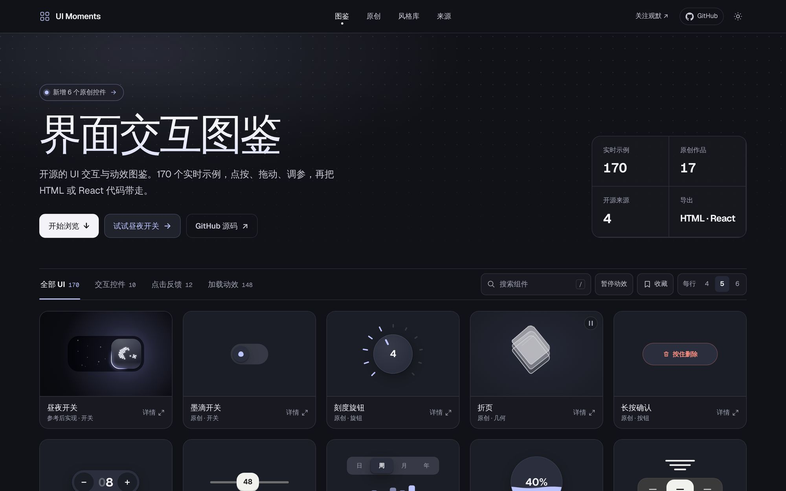

<div align="center">

<a href="https://guanmo-ai.github.io/ui-moments/"></a>

# UI Moments · 界面图鉴

**开源的 UI 交互与动效图鉴。** 170 个可以直接上手的实时示例：点按、拖动、调参，再把 HTML 或 React 代码带走。

[](https://github.com/guanmo-ai/ui-moments/actions/workflows/pages.yml)
[](LICENSE)
[](package.json)
[](CONTRIBUTING.md)

[**打开在线图鉴 ↗**](https://guanmo-ai.github.io/ui-moments/) · [原创控件](https://guanmo-ai.github.io/ui-moments/gallery/originals/) · [风格库](https://guanmo-ai.github.io/ui-moments/styles.html) · [致谢与来源](CREDITS.md) · [English](README.en.md)

<a href="https://guanmo-ai.github.io/ui-moments/">
  <picture>
    <source media="(prefers-color-scheme: light)" srcset="docs/assets/preview-light.jpg">
    
  </picture>
</a>

</div>

## 为什么是 UI Moments

- **先上手，再看代码。** 每张卡片的上半部分就是真实组件，可以直接点按、拖动或暂停；下半部分打开详情、参数和代码。
- **导出即可用。** 加载动效可调尺寸、颜色和节奏，一键复制独立 HTML 或 React 示例，许可证随代码一起带走。
- **复刻提示词。** 每个组件都能复制一段带当前参数、源码链接和许可要求的提示词，交给 AI 编程助手即可复现。
- **来源清清楚楚。** 卡片标注「原创」「开源集成」或「参考后实现」，上游代码原样保存并固定版本，详见 [CREDITS.md](CREDITS.md)。
- **对所有人友好。** 键盘可达、深浅主题、尊重「减少动态效果」，离屏动画自动暂停。

## 收录内容

| 分类 | 数量 | 包含 |
| --- | ---: | --- |
| 交互控件 | 10 | 6 个**原创控件**、昼夜开关、弹性滑尺、对齐拨片、夹页键 |
| 点击反馈 | 12 | Micron.js 的回弹、摆动、闪动效果 |
| 加载动效 | 148 | 11 款原创、44 款 LDRS、47 款 Loading UI、46 款 SVG Spinners |

### 原创控件

从零设计的六个控件，单个 HTML 文件、无依赖，均支持键盘与「减少动态效果」。[一起打开 ↗](https://guanmo-ai.github.io/ui-moments/gallery/originals/)

| | 控件 | 交互 |
| --- | --- | --- |
| ◐ | [墨滴开关](https://guanmo-ai.github.io/ui-moments/#ink-switch) | 拨钮里的墨滴落进轨道并晕开，关闭时沿原路收回 |
| ◎ | [刻度旋钮](https://guanmo-ai.github.io/ui-moments/#detent-dial) | 围绕旋钮拖动，指针被最近的刻度吸住，松手弹回 |
| ▭ | [长按确认](https://guanmo-ai.github.io/ui-moments/#hold-confirm) | 按住填满才执行，中途松手快速退回 |
| ⇅ | [滚轮步进器](https://guanmo-ai.github.io/ui-moments/#odometer-stepper) | 每一位数字像里程表一样朝变化方向滚动 |
| ▤ | [翻页标签](https://guanmo-ai.github.io/ui-moments/#leaf-tabs) | 选中底卡像一页纸翻到新标签 |
| ◒ | [潮汐进度](https://guanmo-ai.github.io/ui-moments/#tide-progress) | 液面按弹簧追上目标，变化越快晃得越厉害 |

## 快速开始

需要 Node.js 22.12+（22 LTS 或 24+）、npm 和 Python 3。

```bash
git clone https://github.com/guanmo-ai/ui-moments.git
```

```bash
cd ui-moments && npm run setup
```

```bash
npm run dev
```

打开 <http://127.0.0.1:5173>。`setup` 按锁文件安装依赖；`dev` 先构建 Loading UI 运行时和 SVG 资源，再启动静态服务。网站本身没有框架，改完刷新即可。

## 项目结构

```text
ui-moments/
├── index.html              # 图鉴首页
├── styles.html             # 风格库：同一个控件的四种外观
├── assets/                 # 站点外壳、画廊逻辑、目录、导出与提示词
│   ├── catalog.mjs         # 汇总所有作品、分类与排序
│   ├── gallery.mjs         # 卡片懒加载、详情、收藏、导出
│   └── site.css            # 全站颜色令牌与导航
├── gallery/
│   ├── works.js            # 交互控件清单（新增控件从这里登记）
│   ├── originals/          # 6 个原创控件
│   ├── elastic-controls/   # 弹性滑尺 / 对齐拨片 / 夹页键 + 风格变体
│   ├── day-night-toggle/   # 昼夜开关（canvas）
│   ├── loaders/            # LDRS 集成、原创加载动效与编辑器
│   ├── loading-ui/         # Loading UI 集成与构建脚本
│   ├── svg-spinners/       # SVG Spinners 集成
│   ├── micron/             # Micron.js 点击反馈
│   └── light-scenes/       # 光照场景实验（独立页面）
├── tools/                  # 测试、打包、逐帧录制
└── docs/                   # 署名规则、分类说明、交接文档
```

## 检查与发布

```bash
npm run build && npm run lint && npm test
```

```bash
npm run package:site && npx playwright install --only-shell chromium && npm run test:browser
```

`npm test` 检查目录、分类、导出与上游许可；浏览器测试把 `_site/` 放在子路径下启动，覆盖画廊、风格库、原创控件、下载与复制。`package:site` 只打包 Git 已跟踪的文件，新文件需先 `git add`。GitHub Actions 对 PR 和主分支执行同样的检查，主分支通过后发布到 GitHub Pages。

## 录制视频

昼夜开关和光照场景由虚拟时钟逐帧推进，输出无掉帧的 60fps 视频。需要先安装 Chromium 与 ffmpeg：

```bash
npm run record:toggle          # out/day-night-toggle.mp4，2880×2160
```

```bash
npm run record:light-scenes    # out/light-scenes.mp4，2880×1800
```

## 参与贡献

欢迎提交新组件、修复和改进。开始之前请阅读 [CONTRIBUTING.md](CONTRIBUTING.md)：它说明了如何新增作品、如何写来源说明，以及哪些内容不能进入仓库。参与即表示同意遵守[行为准则](CODE_OF_CONDUCT.md)。安全问题请按 [SECURITY.md](SECURITY.md) 私下报告。

更新记录见 [CHANGELOG.md](CHANGELOG.md)。

## 许可与致谢

由观默 [@guanmo_ai](https://x.com/guanmo_ai) 创作与维护。UI Moments 自己的代码以 [MIT](LICENSE) 发布。

LDRS（Griffin Johnston / UI Ball）、Loading UI（Bartosz Zagrodzki）、SVG Spinners（Utkarsh Verma）、Micron.js（Webkul）与 Geist 字体（Vercel）保留各自作者的版权与许可。完整清单见 [CREDITS.md](CREDITS.md)，许可证原文见 [THIRD_PARTY_NOTICES.md](THIRD_PARTY_NOTICES.md)。
