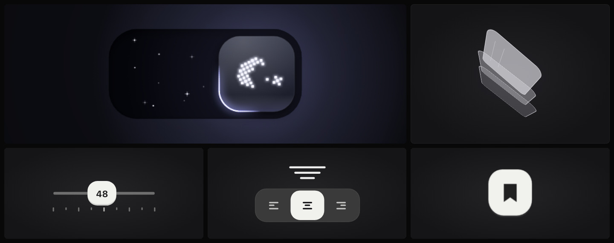

# UI Moments · 界面图鉴

可直接操作的 UI 控件和动效。加载动效支持调参、导出代码和复制复刻提示词。

[**打开在线图鉴 →**](https://guanmo-ai.github.io/ui-moments/)

[](https://guanmo-ai.github.io/ui-moments/)

[昼夜开关](https://guanmo-ai.github.io/ui-moments/#day-night-toggle) · [折页](https://guanmo-ai.github.io/ui-moments/#paper-fold) · [弹性滑尺](https://guanmo-ai.github.io/ui-moments/#elastic-ruler) · [对齐拨片](https://guanmo-ai.github.io/ui-moments/#alignment-switch) · [夹页键](https://guanmo-ai.github.io/ui-moments/#bookmark-press)

由观默 [@guanmo_ai](https://x.com/guanmo_ai) 创作与维护。LDRS、Loading UI、SVG Spinners 和 Micron.js 的作者与许可见[第三方声明](THIRD_PARTY_NOTICES.md)。

## 本地运行

需要 Node.js 22.12+（22 LTS 或 24+）、npm 和 Python 3。在仓库根目录运行：

```bash
npm run setup
npm run dev
```

打开 [http://127.0.0.1:5173](http://127.0.0.1:5173)。`setup` 根据锁文件安装依赖，`dev` 先构建所需资源，再启动本地服务。

## 检查与发布

```bash
npm run build
npm run lint
npm test
npm run package:site
npx playwright install --only-shell chromium
npm run test:browser
```

`npm test` 检查分类、导出和随附许可。浏览器测试把 `_site/` 作为站点子路径启动，验证画廊、风格库、下载和复制。`npm run package:site` 使用 Git 已跟踪的站点文件和构建产物，新增站点文件需先加入 Git。GitHub Actions 对主分支的变更和 PR 执行检查，主分支通过后发布到 GitHub Pages。

## 录制视频

昼夜开关和光照场景由虚拟时钟逐帧推进。完成 `npm run setup` 后安装 Chromium 与 ffmpeg，再运行：

```bash
npx playwright install --only-shell chromium
npm run record:toggle          # out/day-night-toggle.mp4，2880×2160，60fps
npm run record:light-scenes    # out/light-scenes.mp4，2880×1800，60fps
```

录制器参数见 [tools/record.js](tools/record.js)。

## 新增作品

1. 在 `gallery/<作品名>/` 添加可操作的页面和 README，记录来源、采用的实现与本站改动。
2. 在 [gallery/works.js](gallery/works.js) 注册组件，并在 [assets/catalog.mjs](assets/catalog.mjs) 确认用途分类。
3. 用画廊卡片、放大详情和独立入口验证组件。来源说明见[参考与署名](docs/attribution.md)，分类规则见[组件分类与展示](docs/component-categories.md)。

## 许可

本项目新增代码以 [MIT](LICENSE) 许可发布。上游代码、资源和字体各自保留原作者声明及许可证。详见[第三方声明](THIRD_PARTY_NOTICES.md)。
